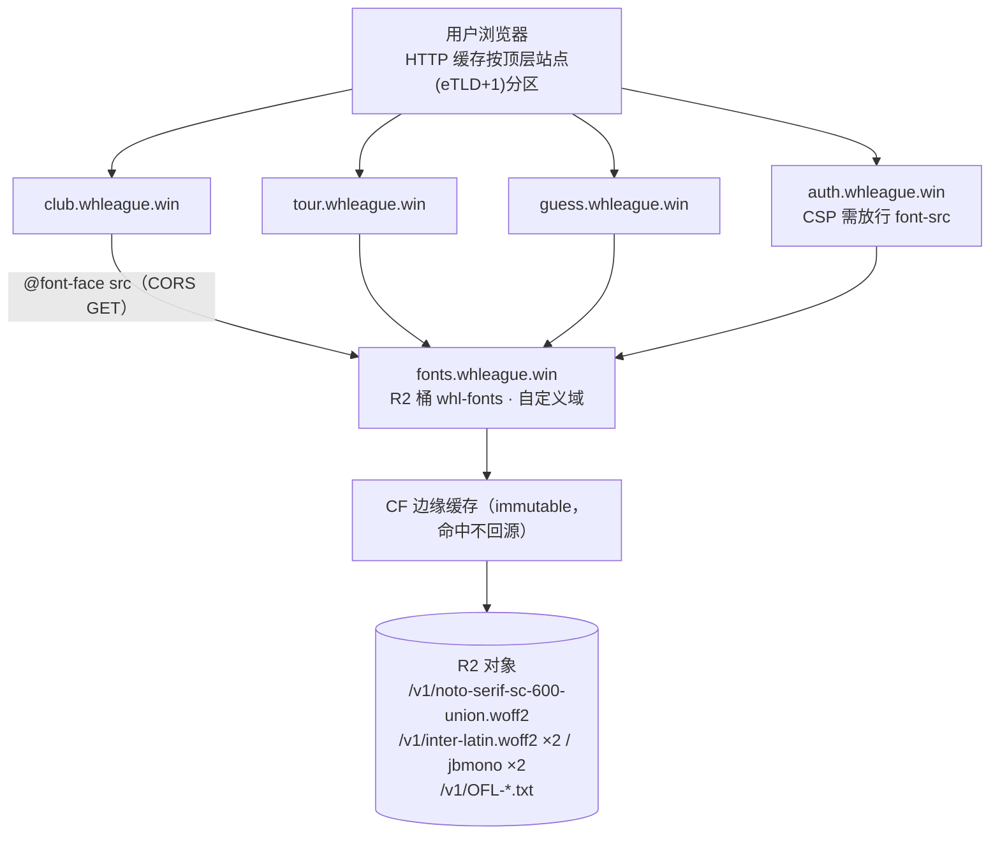

# 共享字体源（探索B · 平台级推荐终态）实现方案设计

- 日期：2026-10-24
- 状态：rev1 设计稿，未拍板；不改代码、不执行任何 R2/DNS 写操作
- 前置：探索A（各仓自配）已全平台落地 —— club v6.53.2 / tour v5.8.1–5.8.3 / guess v1.1.1 / auth v4.0.3，本文给的是下一步的**平台级推荐终态**
- 技能：font-loading-and-performance、international-typography、variable-fonts、architecture-designer
- 相关：`memory/plan-v6.53.2-font-scheme.md`（club）、`WHL-tournament-management-system/memory/plan-v5.8.1-font-scheme.md`、`WHL-auth-service/docs/plan-v4.0.3-font-scheme.md`、`WHL-Daily-Activities-System/docs/plan-v1.1.1-font-scheme.md`

## 0. 一句话结论

四仓 `@font-face` 的 `src` 从各自 `/fonts/…` 相对路径切到 **`https://fonts.whleague.win/v1/…`**（R2 专用桶 `whl-fonts` + 自定义域；版本化不可变路径 + CORS `*` + `immutable` 长缓存），衬线子集合并为**四仓并集单文件（实测并集仅 1611 字，预测约 300KB，与 club 现子集几乎同大）**，切换稳定后删除各仓本地 woff2 副本。收益：四站全访用户字体首次下载 **1.43MB → 约 0.47MB（−67%）**，字体资产与子集管线从 4 份收敛到 1 份。

## 1. 现状盘点（探索A 全平台落地后的实测，2026-10-24）

### 1.1 四仓字体清单

| 仓 | 域名 | 衬线范围 | 衬线子集 | Inter/JBMono | preload | CSP | 字体测试锁 | 计划文件 |
|---|---|---|---|---|---|---|---|---|
| club | club.whleague.win | h1–h3（≥17.5px） | 298,088 B（2187 字 / CJK 1526） | 4 件 178,372 B | inter-latin | 无 | 无（v6.53.2 未加字体断言） | `memory/plan-v6.53.2-font-scheme.md` |
| tour | tour.whleague.win | 报头/大标题 4 选择器 | 276,784 B（2023 字 / CJK 1409） | 同上 4 件 | inter-latin | 无 | TEST_PLAN 字体用例 | tour `memory/plan-v5.8.1-font-scheme.md` |
| guess | guess.whleague.win | 鸣谢弹窗两选择器 | 174,704 B（1111 字 / CJK 871） | 同上 4 件 | inter-latin ×2 页 | 无 | `tests/fonts.test.ts` 5 例（含五文件体积锁） | guess `docs/plan-v1.1.1-font-scheme.md` |
| auth | auth.whleague.win | 不上衬线（h1 仅 18px） | 无 | 同上 4 件 | inter-latin | **`default-src 'self'`（`src/lib/csp.ts:15`）会拦跨源字体** | `tests/e2e/fonts.test.mjs` 4 例 | auth `docs/plan-v4.0.3-font-scheme.md` |

### 1.2 关键实测

- **Inter 与 JetBrains Mono 的 4 个 woff2 四仓 sha256 逐字节相同**（inter-latin `f052ee44…` 48,444 B 等）——同一套文件被复制了 4 份，每个仓各自随构建发布一遍。
- **衬线子集三份各异**（club `5cf6bfd6…` / tour `98c9eb28…` / guess `e86dc68e…`），各仓按自己的源码 + 20 队名各自子集化，三仓脚本三份拷贝（club `scripts/build-serif-subset.py`、tour/guess 各自 `scripts/build-fonts.py`）。
- **四仓源码 CJK 并集扫描（2026-10-24，含中文标点，含各自 src/web/public/cron 源码）**：

| 仓 | 源码唯一 CJK+标点 | 与子集口径对照 |
|---|---|---|
| club | 1542 | 子集 CJK 1526，扫描口径 ≈ 子集口径（系数 0.990） |
| tour | 1096 | 子集 CJK 1409（子集多出的是队名/标点补充） |
| guess | 857 | 子集 CJK 871 |
| auth | 806 | 不上衬线，仅作并集贡献 |
| **四仓并集** | **1611** | club∩tour 1046、club∩guess 831、三仓共同 776 —— **并集只比 club 单仓多 4.5%** |
- **重复维护成本已经真实发生**：`--mono` 栈 `ui-monospace` 抢首位的 bug 在 club（v6.53.2 F4）与 tour（v5.8.1 F4「club 同款 bug」）各修了一遍。

## 2. 为什么「共享源」在本平台成立（技术事实，已查证）

1. **浏览器 HTTP 缓存按「顶层站点」分区，站点按 `scheme://eTLD+1` 计算**（Chrome 86 起，Safari/Firefox 同理）。club / tour / guess / auth 的顶层站点同为 `https://whleague.win`，因此**同一字体 URL 在四站之间共享同一条缓存**。这同时解释了为什么第三方字体 CDN（Google Fonts 等）拿不到这个收益——分区终结了跨站缓存共享，唯一合法的共享面就是「部署在同一注册域下的自建共享源」。
2. **字体加载天然是 CORS 模式 fetch**：跨源字体必须由字体源回 `Access-Control-Allow-Origin`；preload 字体必须带 `crossorigin`（即使同源也要，否则双下载）。四仓现有 preload 都已带 `crossorigin`。
3. **R2 自定义域的流量走 Cloudflare 边缘缓存并尊重对象元数据上的 `Cache-Control`**（`r2.dev` / S3 API 端点不走缓存，必须自定义域）。对象级 `public, max-age=31536000, immutable` 在上传时写入。
4. woff2 本身已压缩，无传输层再压缩议题；版本化路径 + immutable 意味着**边缘与浏览器都不再回源验证**，回滚依赖「老版本路径常驻」而不是缓存失效。
5. 字体 GET 是简单请求（无自定义头），**不触发 CORS 预检**，无 OPTIONS 开销。

## 3. 候选方案对比

| 方案 | 说明 | 跨站缓存复用 | 治理 | 成本/基建 | 结论 |
|---|---|---|---|---|---|
| **B0 维持现状**（探索A） | 四仓各自托管 | ✗ | 4 份资产 + 3 份子集脚本，已付过重复修 bug 的成本 | 零 | 基线，本文要离开它 |
| **B1 R2 专用桶 + 自定义域** | 新桶 `whl-fonts` + `fonts.whleague.win` | ✓ | 单一真源；更新 = 本地生成 + `wrangler r2 object put` | 零计算、零冷启动；桶 CORS + 对象 immutable；免费额度内 | **推荐** |
| B2 专用 assets-only Worker | 新仓 `whl-fonts`，Workers Builds 发布，`_headers` 配 CORS/缓存 | ✓ | git PR 评审流，与四仓肌肉记忆一致 | 多一个仓 + 一个 worker；`_headers` 有根路径/主机通配的已知 bug | 次选；触发条件见 §12 |
| B3 复用 club 域名路径 | tour/auth/guess 引 `club.whleague.win/fonts/…` | ✓ | 字体版本与 club 部署耦合；三仓依赖 club 可用性；club 现路径无版本隔离 | 零新基建 | 弃：耦合 outweigh 收益 |
| B4 第三方字体 CDN | Google Fonts 等 | ✗（分区终结跨站共享） | 版本不受控 | 中国网络不可达/慢；一致性、隐私 | 弃 |

选 B1 而非 B2 的决定性理由：字体更新频率是「新增生僻字才重跑」的量级（月级甚至更低），值不上一个新仓 + CI；R2 对象 put 是字节精确的发布动作，无构建步骤意外；桶级 CORS 与对象级 immutable 都是产品原生能力，不依赖 `_headers` 这类有边角 bug 的新特性。

## 4. ADR

### ADR-1 共享源载体 = R2 专用桶 `whl-fonts` + 自定义域 `fonts.whleague.win`
备选 B2/B3/B4 见 §3。不与 `whl-media` 合桶：media 的公开面走 club worker `/api/media/*` 有自己的鉴权与缓存语义，给 media 桶绑公开自定义域会绕过 worker 直接暴露全部对象。**后果**：多一个桶（免费额度内）与一条面板操作（绑域）。
### ADR-2 衬线子集 = 四仓并集单文件
数据见 §6：并集 1611 字 ≈ club 单仓的 1.045 倍，预测体积 ≈ 300KB；三仓现子集合计 749,576 B。**备选**「每仓子集放共享源」被否：衬线互不复用（URL 不同不共享缓存），只省 Inter/JBMono 的复用；「unicode-range 切片」留作 union 超 ~600KB 时的触发条件（§12）。**后果**：只访问 guess 的用户在打开鸣谢弹窗时多付约 130KB（174,704 → ~306,000，且不 preload、swap 到达）；四站全访用户少付约 444KB。
### ADR-3 `@font-face` 留在各仓 CSS，只把 `src` 指向共享 URL；不做共享 CSS 文件
共享 CSS（`<link href="https://fonts.whleague.win/font-faces.css">`）会把「字体版本」变成跨源渲染阻塞资源、无法用各仓自己的 preload 策略、且四仓 `unicode-range`/字重声明本来就已同构。**后果**：版本号常量在四仓各有一份（治理点见 §5.4 版本对齐）。
### ADR-4 版本化不可变路径：`/v<N>/<file>.woff2`，内容变即升版本，URL 永不改写
immutable 的前提是 URL 内容永不变；发布新版 = 新目录 + 各仓改一处常量。老版本对象**永不删除**（回滚面 + 其他仓未同步升级时的兜底）。**后果**：桶存储按版本线性增长，每版约 0.5MB，可忽略。
### ADR-5 切换验收后删除各仓本地 woff2；OFL 文本随桶分发
消除 4 份冗余与「改了这仓忘那仓」的漂移面（Inter/JBMono 的 sha256 相同纯属自觉，没有机制保证）。OFL-1.1 要求分发时附带许可：桶内放 `/v1/OFL-Inter.txt`、`/v1/OFL-JetBrainsMono.txt`、`/v1/OFL-NotoSerifSC.txt` 公开可取；各仓 `fonts/README.md` 保留、改为链接指向。**回滚** = git revert（各仓独立回，老版本路径常驻共享源，秒级生效不走部署）。
### ADR-6 子集管线收敛到 club 仓单一脚本
`scripts/build-platform-fonts.py`（由现 `build-serif-subset.py` 扩展）：扫四仓源码并集 + 生产 20 队名 + 中文标点 + Latin 区段，产出 union 子集与 `chars.txt`。**假设**：四仓为同目录 sibling checkout（`C:/Users/bhdjb/whlProgram/`），路径作参数可覆盖；假设记入脚本头注释。备选「新 whl-fonts 仓承载管线」过度工程（一个 py 脚本不值一个仓）。

## 5. 终态架构

### 5.1 图



四站顶层站点同为 `https://whleague.win` ⇒ 同一缓存分区 ⇒ Inter/JBMono/union 衬线各只下载一次，四站复用。

### 5.2 桶布局（v1）

```
whl-fonts/
  v1/noto-serif-sc-600-union.woff2   ~306KB（估，§6）  font/woff2
  v1/inter-latin.woff2                 48,444 B（字节同今日四仓）
  v1/inter-latin-ext.woff2             74,328 B
  v1/jbmono-latin.woff2                40,404 B
  v1/jbmono-latin-ext.woff2            15,196 B
  v1/OFL-NotoSerifSC.txt / OFL-Inter.txt / OFL-JetBrainsMono.txt
  v1/MANIFEST.json                    （各文件 sha256 + 字数 + 生成日期 + chars.txt 链接，验收对账用）
```

### 5.3 响应头契约（验收逐条核）

| 头 | 值 | 来源 |
|---|---|---|
| `access-control-allow-origin` | `*` | 桶 CORS 规则（`AllowedOrigins: ["*"]`、`AllowedMethods: [GET]`、`AllowedOrigins` 无凭据语义） |
| `cache-control` | `public, max-age=31536000, immutable` | 对象元数据（put 时写入） |
| `content-type` | `font/woff2`（OFL 为 `text/plain`） | 对象元数据 |

### 5.4 版本与对齐策略

- 各仓 CSS 顶部定义一处常量（或注释锚）`https://fonts.whleague.win/v1/`，5 条 `@font-face` 的 src 与 preload 都从它拼——升版本每仓只改一行。guess/auth 无构建，直接改字符串。
- **版本对齐窗口**：允许四仓版本短暂不齐（老版本路径常驻，不齐的仓继续用老文件，只是不参与跨站复用）；不设硬同步要求。
- 衬线 union 重跑触发：任一仓新增界面文案含新汉字（球队改名/新功能），跑一次 `build-platform-fonts.py` → 升 `/v<N+1>/` → 各仓随手或集中跟升。缺字兜底不变：标题逐字回落 `SimSun`，仍是衬线（club F5 既有口径）。

## 6. 衬线 union 单文件的裁决数据

三仓实测点（字数含 Latin/标点）线性拟合：`体积 ≈ 47.3KB + 114.7 B/字`（tour 预测 279.4KB vs 实测 276.8KB，误差 <1%）。

| 口径 | 体积 | 说明 |
|---|---|---|
| club / tour / guess 现子集各一份 | 298,088 + 276,784 + 174,704 = **749,576 B** | 今日三衬线仓各下一次 |
| union 单文件（预测） | 47.3KB + 2255 字 × 114.7B ≈ **306,000 B** | 总字数 ≈ 661（Latin/标点，取 club 口径）+ 1594（并集 CJK 折算）；±10% 估算，落桶前以脚本实测为准 |
| club 单仓用户代价 | 298,088 → ~306,000（**+8KB**） | 可忽略 |
| guess 单仓用户代价 | 174,704 → ~306,000（**+131KB**） | 仅开鸣谢弹窗时、swap 不阻塞 |
| 四站全访用户收益 | 见 §7 收益表 | |

## 7. 收益与开销

### 7.1 传输（首次访问、四站全逛、各模块都触达的最坏口径）

| | 今日（探索A） | 终态（B1 + union） |
|---|---|---|
| Inter/JBMono | 178,372 × 4 = 713,488 B | 178,372 × 1 |
| 衬线 | 749,576 B（三份） | ~306,000 B（一份） |
| **合计** | **1,463,064 B（1.43MB）** | **~484,000 B（0.47MB），−67%** |

常用路径（不触发 latin-ext 懒加载、auth 只下 inter-latin）今日也约 880KB → 终态约 395KB。二次访问起两边都吃缓存，差异归零——收益集中在「四站全访的首次」与「版本升级后的首次」。

### 7.2 R2 免费档开销（量级）

存储 <1MB/版（免费 10GB）；Class B（GET）仅边缘未命中时计（免费 10M/月），边缘命中后四站共享；Class A（put）每次发布 6 次。**结论：远低于任何档位阈值，无需监控。**

## 8. 各仓切换清单（差异点）

| 仓 | 改动 | 测试联动 |
|---|---|---|
| club | `web/src/styles.css` 5 条 `src` 与 `web/index.html` preload 改绝对 URL（`crossorigin` 已在） | 无字体断言；`tests/domains.test.ts` 的 apex 扫描不受影响（`fonts.whleague.win` 是子域，正则不误伤） |
| tour | `src/styles.css` 5 条 + `index.html` preload | TEST_PLAN 字体用例的 URL 断言更新 |
| guess | `public/style.css` 5 条 + `index.html`/`admin.html` 两条 preload | `tests/fonts.test.ts` 5 例改锁：体积锁改为「共享 URL + 版本一致性」锁（体积锁随 union 重跑即失效） |
| auth | `src/lib/csp.ts` 的 BASE_CSP 加 `font-src https://fonts.whleague.win`；`src/web/layout.ts` 4 条 `src` + preload 改绝对 URL | `tests/e2e/fonts.test.mjs` 4 例改写：CSP 边界例改断言 `font-src` 在场、字体 200/字节数改打共享源、未知字体 404 改桶上探测 |
| 四仓共同 | 阶段 4 删 `*.woff2`（README 保留改链接 + OFL 指桶）；auth 可进一步撤 `assets` 绑定（其 public/ 只剩 fonts，撤前留一轮兜底） | 各仓 VERSIONS/CHANGELOG 记 patch |

## 9. 落地阶段（每阶段独立可上线、可独立 git revert）

**阶段 0 · 基建（需用户授权的写动作 + 面板操作）**
1. `wrangler r2 bucket create whl-fonts`（remote 写，待授权）。
2. club 仓写 `scripts/build-platform-fonts.py`，生成 union 子集与 MANIFEST（本地，无授权需要）。
3. 上传 v1（`wrangler r2 object put whl-fonts/v1/<f> --file <f> --content-type font/woff2 --cache-control "public, max-age=31536000, immutable"`；**命令拼写未本地验证**——r2 写不在本轮授权内，执行前先 `--help` 核对）。
4. 配桶 CORS：`wrangler r2 bucket cors set whl-fonts --file cors.json`（已知 wrangler 有 CORS 文件校验 bug 的 issue，失败则面板 → 桶 Settings → CORS Policy 手工贴）。
5. 面板给桶绑自定义域 `fonts.whleague.win`（R2 → bucket → Settings → Custom Domains → Connect Domain；面板路径以当前 UI 为准）。
6. 只读验收 §10 TC-0 系列（不碰任何应用仓）。

**阶段 1 · club 切换**（patch，本地 fonts 保留一轮作回滚垫）→ e2e 29 场景 + 跨站缓存复用实测（此时可与 tour 对照）。
**阶段 2 · tour / guess 切换**（各自 patch；guess 测试锁同轮改）。
**阶段 3 · auth 切换**（CSP + e2e 改写；这是唯一动安全面的仓，单独一枚提交）。
**阶段 4 · 清理**：四仓删 woff2、README 改链接、auth 撤 assets（撤前确认无旧 HTML 缓存依赖，404 也有回退栈兜底）；平台记忆与本文档状态行更新。

任一阶段失败回滚：该仓 git revert 即回本地自托管（阶段 4 前）；阶段 4 后回滚 = revert + 恢复字体文件（git 里都有）。

## 10. 验收口径（最坏情况优先）

| TC | 内容 |
|---|---|
| TC-0a | `fonts.whleague.win/v1/inter-latin.woff2` 响应头三件套（§5.3）逐条在场；二次请求 `cf-cache-status: HIT` |
| TC-0b | 匿名跨源 GET（模拟 `Origin: https://club.whleague.win`）回 `access-control-allow-origin: *`；无 Origin 的普通 GET 也 200 |
| TC-0c | union 子集覆盖性：四仓各抽衬线标题文本（club 页面标题 / tour 报头与战报标题 / guess 鸣谢文案）逐字在 `chars.txt` 内，浏览器渲染无豆腐、无 SimSun 逐字混排 |
| TC-0d | `/v1/OFL-*.txt` 三件公开 200 |
| TC-1 | club 切换后：清缓存访问 club（下载 4+1 件）→ 直访 tour（未切，仍下本地份）→ DevTools 证 club 的 inter-latin 是网络请求；切完四仓后重复实验：第二站起的共享字体显示 `(disk cache)`/`(memory cache)` 且字节数不计入网络——**这是本方案核心收益的直接证据** |
| TC-2 | preload 双下载检查：network 面板 inter-latin 只一条请求（`crossorigin` 与 CORS 命中） |
| TC-3 | latin-ext 懒加载不回归：普通页面无 `inter-latin-ext` 请求 |
| TC-4 | **共享源整体不可用（最坏）**：断网/改 hosts 模拟 `fonts.whleague.win` 530 → 四站逐站可读（标题落 SimSun/系统栈、正文系统黑体、数字回退等宽栈），无 FOIT、无布局破相 —— 四仓 stack 设计（探索A F2/F5）即兜底，逐站截图留档 |
| TC-5 | CORS 错配模拟（阶段 0 未配 CORS 的真实窗口）：字体不加载 + 控制台 CORS 报错，页面照常可读 |
| TC-6 | auth：CSP 头含 `font-src https://fonts.whleague.win`；`/login` 字体 200；e2e fonts 4 例改写后全绿；`data:` 与其他外部源仍被拦（CSP 收紧面没有放松） |
| TC-7 | 版本常驻：发布 `/v2/` 后 `/v1/` 仍 200（回滚面） |
| TC-8 | guess 体积锁改 URL 锁后：`@font-face` 全 `swap`、无 `local()`、preload 只 inter-latin 等既有断言不回归 |

## 11. 风险与最坏情况

| 风险 | 现象 | 兜底 |
|---|---|---|
| R2 / fonts 域名故障 | 四站字体全部回退系统栈 | swap + 多级回退栈（TC-4 验证）；无阻塞渲染路径 |
| CORS 配错 | 字体不加载 + 控制台报错 | 回退栈；面板重配即愈，无部署 |
| 浏览器改缓存分区粒度（如按完整源） | 跨站复用退化为与现状同（每站各下） | 不劣于探索A，纯收益衰减 |
| union 漏字（新文案未重跑） | 新字落 SimSun 逐字回退，仍是衬线 | club F5 既有口径；重跑脚本升版即愈 |
| 四仓版本漂移不齐 | 漂移仓不参与跨站复用 | 老版本常驻；无正确性影响（§5.4） |
| auth CSP 遗漏 font-src | auth 字体不加载回 Arial/系统栈 | TC-6 前置拦截；e2e 锁死 |
| `wrangler r2 bucket cors set` 校验 bug | cors.json 被拒 | 面板手工贴（§9 阶段 0.4） |

## 12. 明确不做 / 触发条件留档

- **不做 metric-matched fallback / size-adjust**：当前衬线行高固定 1.6、CJK 字宽 1em，首屏未见明显跳动（club v6.53.2 §5）；留给「实测 CLS 出问题」时再做。
- **不做 variable 再评估**：Inter/JBMono 现文件本就是 variable 子集（四仓 `@font-face` 均声明 `font-weight: 100 900` / `100 800`）；衬线按 variable-fonts 技能的 break-even 表（1–2 实例静态赢）维持 600 单字重。
- **不做 CJK unicode-range 切片**：union 约 300KB 时单文件更简单；**触发条件**——union 实测超 ~600KB（如未来界面文案爆炸）再评估按字频切片（浏览器只下命中分片，天然按需）。
- **不做共享 CSS / 不给中文正文上网络字体**（探索A F2/F6 口径不变）。
- **B2（专用 assets-only Worker 仓）复活条件**：字体更新频率升到「周级且需 PR 评审」（如未来每轮赛事换展示字体）。

## 13. 参考来源（本文引用的技术事实）

- Chrome HTTP 缓存分区（Network Isolation Key = 顶层站点 + 帧站点，`scheme://eTLD+1`）：[developer.chrome.com/blog/http-cache-partitioning](https://developer.chrome.com/blog/http-cache-partitioning)、[XS-Leaks Wiki · Partitioned HTTP Cache](https://xsleaks.dev/docs/defenses/secure-defaults/partitioned-cache)
- R2 自定义域走 CF 缓存、对象 Cache-Control 生效：[Enable cache in an R2 bucket](https://developers.cloudflare.com/cache/interaction-cloudflare-products/r2)、[Default Cache Behavior](https://developers.cloudflare.com/cache/concepts/default-cache-behavior)、[Cache Rules: Edge TTL](https://developers.cloudflare.com/cache/how-to/cache-rules/settings)
- R2 桶 CORS 配置：[Configure CORS · R2 docs](https://developers.cloudflare.com/r2/buckets/cors)、wrangler `r2 bucket cors set` 的已知校验 bug（[workers-sdk#8486](https://github.com/cloudflare/workers-sdk/issues/8486)）
- Workers Assets `_headers`（B2 备选依据）：已知根路径/主机通配 bug（[workers-sdk#11351](https://github.com/cloudflare/workers-sdk/issues/11351)、[workers-sdk#9865](https://github.com/cloudflare/workers-sdk/issues/9865)）
- R2 对象 Cache-Control 需上传时写入元数据：[Stack Overflow](https://stackoverflow.com/questions/77642861/can-i-set-cloudflare-r2-cache-control-max-age)
